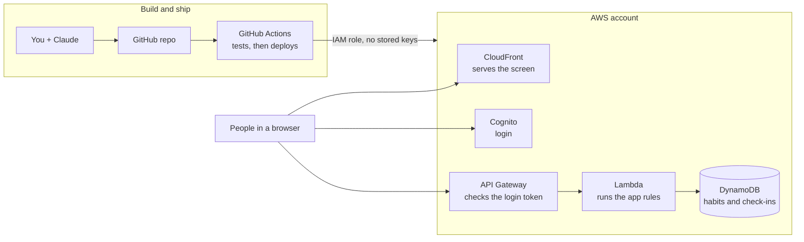

# Architecture

## The map

## What each piece does

| Piece                  | Its job, in plain words                                              | Tool                     |
| ---------------------- | -------------------------------------------------------------------- | ------------------------ |
| Screen (UI)            | What people see and click                                            | React + TypeScript, Vite |
| Hosting                | Sends the screen to any browser, worldwide, over HTTPS               | S3 + CloudFront          |
| Login                  | Proves who you are, then hands the browser a signed note (a token)   | Cognito                  |
| Front door             | Turns away any request without a valid token                         | API Gateway (HTTP API)   |
| Backend                | The app's rules: checks input, reads and saves data                  | Hono on Lambda           |
| Database               | Remembers habits and check-ins, per person                           | DynamoDB, one table      |
| Repo                   | The source of truth and the full history of every change             | GitHub                   |
| Unit tests             | Small automatic checks that answer green or red                      | Vitest                   |
| CI/CD                  | Checks every change (CI), ships `main` to AWS (CD)                   | GitHub Actions           |
| Infrastructure as code | Every AWS resource written in the repo, so it can be rebuilt exactly | AWS CDK                  |
| Deploy identity        | How the pipeline gets into AWS with no password stored anywhere      | IAM role via GitHub OIDC |
| Logs and alarms        | Seeing what happened when something breaks                           | CloudWatch               |
| Cost guardrail         | An email before a mistake becomes a bill                             | AWS Budgets, $5 a month  |

## Decisions

| Decision        | Chosen                               | Why                                                            | Revisit when                               |
| --------------- | ------------------------------------ | -------------------------------------------------------------- | ------------------------------------------ |
| App             | Habit tracker                        | Per-user data makes login matter; streaks give tests real work | Never; it is the teaching vehicle          |
| Shape           | Serverless (Lambda + DynamoDB)       | Costs about $0 when idle; nothing to patch                     | A second project that wants SQL (Postgres) |
| Language        | TypeScript end to end                | One language for screen, backend and infrastructure            | -                                          |
| Wiring          | Explicit CDK, not Amplify            | Every connection is visible and explainable                    | -                                          |
| Access to AWS   | Pipeline assumes a role through OIDC | No AWS keys in chat, in GitHub, or on a laptop                 | -                                          |
| Region          | `us-east-1`                          | Closest to DC; every service is available there                | -                                          |
| Repo visibility | Public                               | It is the portfolio; it never contains secrets                 | -                                          |

## Build order

| Phase | Builds                                                                | You can see                            |
| ----- | --------------------------------------------------------------------- | -------------------------------------- |
| 0     | Repo, folders, TypeScript, lint, first unit tests, CI                 | A green check on GitHub                |
| 1     | Month grid with sample data; S3 + CloudFront via CDK; deploy pipeline | A public HTTPS address anyone can open |
| 2     | API on Lambda, DynamoDB table, saving check-ins                       | Data still there after a reload        |
| 3     | Cognito sign-up and login; API rejects requests without a token       | Two accounts, two separate boards      |
| 4     | Error alarm, budget alert, backups, branch protection, a dev copy     | An alarm email triggered on purpose    |
| 5     | Optional: a browser test (Playwright), then new features              | -                                      |

Between Phases 2 and 3 the API is open to anyone with its address. That is acceptable with sample data, and it makes the moment login arrives easy to see.
